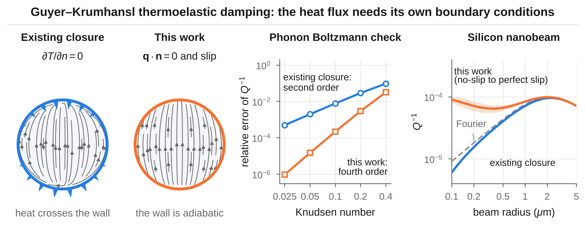

# Guyer–Krumhansl thermoelastic damping with heat-flux boundary conditions

Python code and computed data for the article

> B.-R. Peng *et al.*, "Consistent heat-flux boundary conditions for Guyer–Krumhansl thermoelastic
> damping in micro- and nanoresonators: kinetic validation, energy identity and a mixed finite
> element method", submitted to the *International Journal of Mechanical Sciences*.
> <!-- TODO: full author list; volume, article number and DOI after publication -->

The repository reproduces every figure and table of the article and contains the scripts of the
independent checks. Only NumPy, SciPy and Matplotlib are required; no mesh generator and no finite
element library is used.



## Content of the article in one paragraph

Thermoelastic damping of beam resonators is modelled with the Guyer–Krumhansl law, in which the
heat flux obeys its own differential equation. The code solves the thermal problem on the beam
cross-section in three ways: (i) the temperature-only closure with `dT/dn = 0` used in earlier
analyses, (ii) the formulation with zero normal heat flux and a slip condition for the tangential
flux, in closed form for slab and circular sections and by a mixed finite element method for
arbitrary sections, and (iii) a gray phonon Boltzmann reference for the slab.

## Requirements

```
pip install -r requirements.txt
```

Tested with Python 3.13, NumPy 2.5.3, SciPy 1.18.1 and Matplotlib 3.11.2. Pillow is needed only
for the TIFF file of the graphical abstract.

## Layout

| Path | Content |
|---|---|
| `code/` | all scripts; run each script from inside `code/` |
| `figures/` | figures of the article (`fig_*.pdf`) and the graphical abstract, as produced by the scripts |
| `tables/` | bodies of the tables of the article (`tab_*.tex`), as produced by the scripts |
| `*.json`, `*_output.txt` | stored results of the runs used in the article |

The scripts write to `../figures`, `../tables` and `../` relative to `code/`. Three result files
are reused as a cache when they exist (`fem_results.json`, `rect_omega.json`, `bte_results.json`);
delete a cache file to force the computation.

## Quick start

```
cd code
python verify.py              # closed forms against independent discretisations, energy identity
python peaks.py               # Table "peaks" (a few seconds)
python figures.py             # closed-form figures and tables
python graphical_abstract.py  # graphical abstract
```

## Libraries

| File | Content | Article |
|---|---|---|
| `gkted.py` | closed-form solutions (slab, disk), wall law, non-dimensionalisation, beam frequencies | Sections 2–3, Appendix A |
| `bte1d.py` | gray phonon Boltzmann reference: specular series and discrete ordinates | Section 4, Algorithm 1 |
| `fem_mesh.py` | graded triangular meshes of disks and rectangles | Section 5.6 |
| `fem_scalar.py` | isoparametric P2 elements for the temperature-only closures and the wall law | Section 3.4 |
| `fem_mixed.py` | mixed BDM1–P0 method on straight-sided triangles | Section 5 |
| `fem_mixed_curved.py` | mixed BDM1–P0 method on Piola-mapped P2 triangles (main method) | Section 5, Algorithms 2–3 |

## Scripts that produce the figures and tables

| Script | Output |
|---|---|
| `figures.py` | `fig_slab_qinv`, `fig_disk_qinv`, `fig_error_map`, `fig_asymptotics`, `tab_slab.tex`, `tab_disk.tex`, `tab_verify.tex`, `results.json` |
| `peaks.py` | `tab_peaks.tex`, `peaks.json` |
| `wall_table.py` | `tab_wall.tex`, `wall_table.json` |
| `wall_resonance.py` | `tab_reson.tex`, `wall_resonance.json` |
| `bte_results.py` | `tab_bte.tex`, `bte_results.json` |
| `bte_figs.py` | `fig_bte`, `fig_bte_phase` |
| `rect_omega.py` | `rect_omega.json` (frequency sweeps on rectangles; slow) |
| `fem_results.py` | `fig_fem_conv`, `fig_sidewall`, `tab_fem_conv.tex`, `tab_fem_robust.tex`, `tab_si_rect.tex`, `fem_results.json` |
| `fields_figs.py` | `fig_setup`, `fig_fields`, `tab_ellipse.tex`, `ellipse_results.json` |
| `alpha_results.py` | `fig_alpha`, `tab_alpha_kn.tex`, `tab_alpha_si.tex`, `alpha_results.json` |
| `rates_check.py` | `tab_rates.tex`, `rates_check.json` |
| `graphical_abstract.py` | `graphical_abstract.pdf`, `.png`, `.tiff` |

Order for a full rebuild: `figures.py`, `peaks.py`, `wall_table.py`, `wall_resonance.py`,
`bte_results.py`, `bte_figs.py`, `rect_omega.py`, `fem_results.py`, `fields_figs.py`,
`alpha_results.py`, `rates_check.py`, `graphical_abstract.py`. The finite element scripts take from
minutes to about an hour on one core.

## Independent checks

| Script | What is checked |
|---|---|
| `verify.py` | closed forms against finite differences (slab) and Chebyshev collocation (disk); energy identity |
| `asymptotics.py` | first-order Knudsen-layer formula on the disk |
| `asym_exact_check.py` | exact Knudsen-layer factor and the orders of its expansions (Appendix A) |
| `audit_theory.py`, `audit_fem.py` | re-derivation checks of the propositions; positivity of the penalty form; wall-law resonances |
| `alpha_checks.py` | general coefficient of the grad-div term: closed forms against finite elements |
| `coercivity_check.py` | coercivity constant of the quasi-optimality proof |
| `rect_check2.py`, `test_curved.py`, `test_fem_scalar.py` | short convergence tests of the solvers |

## Correspondence between the pseudocode of the article and the code

- Algorithm 1: `bte1d.bte_dom` and the Richardson step in `bte_results.py`.
- Algorithm 2: `fem_mixed_curved.build` and `fem_mixed_curved.assemble`. In the code `Vq` is E + D,
  `Vd` is D, `Jq` is J, `Bn` is N and `Bt` is R.
- Algorithm 3: `fem_mixed_curved.solve`; the energy check is done in the result scripts.

## Minimal example

```python
import numpy as np
import gkted as g, fem_mesh as fm, fem_mixed_curved as mc

Lam, L, tau_hat = 3.39j, 0.1, 1e-3j          # i*Omega, l/a, tau*lambda
mesh = fm.disk_mesh(0.1, grade=(0.4, L / 4))  # unit disk, graded towards the wall
S = mc.build(mesh); A = mc.assemble(S, L)
for name, slip in (('no-slip', 0.0), ('slip', L), ('perfect slip', np.inf)):
    r = mc.solve(A, Lam, L, tau_hat, slip)
    exact = g.disk_I(Lam, L, tau_hat, slip, 'slip')
    print(f'{name:13s} -Im I = {-r["I"].imag:.6f}   exact = {-exact.imag:.6f}')
```

The inverse quality factor is `Q^-1 = Delta_E * |Im I|`.

## License

<!-- TODO: choose a licence before the repository is made public and add a LICENSE file
     (for example MIT for the code and CC BY 4.0 for the data and figures). -->
To be added by the authors.

## Citation

See `CITATION.cff`. Until the article is published, please cite the repository.
